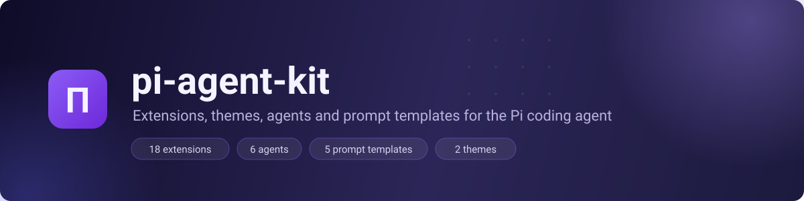

<div align="center">
  

  [](LICENSE)
  [](https://github.com/aldoborrero/pi-agent-kit/actions/workflows/npm-publish.yml)
  [](https://github.com/badlogic/pi-mono)

</div>

A toolkit of **extensions, themes, agents, and prompt templates** for the [Pi coding agent](https://github.com/badlogic/pi-mono). It ships as a Bun workspace of 18 local `pi-*` packages — code intelligence, safety, session context, automation, voice, and UI — wired together by a single aggregator package, so **one install gets you everything**.

## Installation

```bash
# From a git repository
pi install git:github.com/aldoborrero/agent-kit

# From npm (once published)
pi install npm:@aldoborrero/pi-agent-kit

# From a local clone
pi install ./agent-kit
```

Restart Pi afterwards. The aggregator (`pi-agent-kit`) activates every local extension plus the pinned external packages listed below — you don't need to install any of them separately.

## What you get

- **16 extensions** loaded through the aggregator — structural search, enhanced editing, sandboxing, Bitwarden, suggestions, voice, and more
- **2 extensions** loaded from their own entries: [`@bacnh85/pi-subagent`](https://www.npmjs.com/package/@bacnh85/pi-subagent) (task delegation) and [`@quintinshaw/pi-dynamic-workflows`](https://www.npmjs.com/package/@quintinshaw/pi-dynamic-workflows) (deterministic workflow orchestration)
- **6 agents** (`agents/`): explore, plan, build, review, debug, brainstorm — lean markdown system prompts that inherit the session model
- **5 prompt templates** (`prompts/`): brainstorm, debug, explore, full-cycle, review — loaded as slash commands
- **2 themes**: `lavender` (shipped by pi-themes) plus [`@xynogen/pix-themes`](https://www.npmjs.com/package/@xynogen/pix-themes)

### Examples

Once installed, you get commands like:

```text
/until tests              # repeat the last request until tests pass
/loop 5m /until tests     # run a prompt on a recurring timer
/websearch "pi changelog" # open the search curator
/voice                    # toggle speech-to-text recording
/diff                     # view uncommitted changes
/btw "quick question"     # parallel side conversation in a sub-session
```

## Extension catalog

### Bundle

| Package | Description |
|---------|-------------|
| [`pi-agent-kit`](extensions/pi-agent-kit) | Meta-package — installs all pi-* extensions below |

### Code Intelligence

| Extension | Description |
|-----------|-------------|
| [`pi-ast-grep`](extensions/pi-ast-grep) | Structural code search using AST patterns |
| [`pi-edit`](extensions/pi-edit) | Enhanced `edit` tool — single, batch (`multi`), and Codex-style patch modes |
| [`pi-diff`](extensions/pi-diff) | Structured diff rendering |
| [`pi-tuicr`](extensions/pi-tuicr) | Interactive code review launcher |

### Safety

| Extension | Description |
|-----------|-------------|
| [`pi-bitwarden`](extensions/pi-bitwarden) | Secure vault access via rbw — `bw_get`/`bw_list` with password masking |
| [`pi-sandbox`](extensions/pi-sandbox) | OS-level sandboxing for bash commands |
| [`pi-rewind-hook`](https://github.com/nicobailon/pi-rewind-hook) | External — file-state rewind points, restorable from `/fork` and `/tree` |

### Session & Context

| Extension | Description |
|-----------|-------------|
| [`pi-context`](extensions/pi-context) | `/context` TUI — token usage, extensions, skills, session cost |
| [`pi-alias`](extensions/pi-alias) | `/exit` (alias for `/quit`) and `/clear` (alias for `/new`) commands |
| [`pi-suggest`](extensions/pi-suggest) | Next-prompt prediction — ghost text suggestions after each turn |
| [`pi-btw`](https://github.com/dbachelder/pi-btw) | External — parallel `/btw` side conversations in a real sub-session with tool access |
| [`@luxusai/pi-hindsight`](https://www.npmjs.com/package/@luxusai/pi-hindsight) | External — durable Hindsight-backed long-term memory (`hindsight_*` tools) |

### Workflow & Automation

| Extension | Description |
|-----------|-------------|
| [`@bacnh85/pi-subagent`](https://www.npmjs.com/package/@bacnh85/pi-subagent) | External — delegate tasks to specialized subagents (single, parallel, chain) |
| [`pi-loop`](extensions/pi-loop) | Schedule, list, or delete recurring prompts on a timer |
| [`pi-until`](extensions/pi-until) | Repeat until a condition is met |
| [`@juicesharp/rpiv-ask-user-question`](https://github.com/juicesharp/rpiv-mono/tree/main/packages/rpiv-ask-user-question) | External — structured questions with multi-select, previews, and notes |

### Search & Web

| Extension | Description |
|-----------|-------------|
| [`pi-web-access`](https://github.com/nicobailon/pi-web-access) | External — web search, page/PDF extraction, repository and video access |

### Environment & Integration

| Extension | Description |
|-----------|-------------|
| [`pi-direnv`](extensions/pi-direnv) | Auto-load direnv environment variables |
| [`pi-codex`](extensions/pi-codex) | OpenAI Codex integration — review and rescue tasks |
| [`@bacnh85/pi-notify`](https://github.com/bacnh85/pi-extensions/tree/main/pi-notify) | External — desktop notifications for completion, errors, and questions |
| [`pi-phoenix`](https://github.com/philipbjorge/pi-phoenix) | External — OpenTelemetry tracing to Arize Phoenix |

### Input & Voice

| Extension | Description |
|-----------|-------------|
| [`pi-voice`](extensions/pi-voice) | Speech-to-text — Groq, OpenAI, or local Whisper |

### UI

| Extension | Description |
|-----------|-------------|
| [`pi-footer`](extensions/pi-footer) | Custom footer with git branch, tokens, status |
| [`pi-themes`](extensions/pi-themes) | Ships the `lavender` theme |

### Utility

| Extension | Description |
|-----------|-------------|
| [`pi-common`](extensions/pi-common) | Shared `createUiColors` and color utilities |

## Configuration

Most integrations work out of the box; API-backed ones need keys. Copy `.envrc.local-template` to `.envrc.local` and fill in what you use:

```bash
cp .envrc.local-template .envrc.local
direnv allow
```

| Variable | Extension | Description |
|----------|-----------|-------------|
| `GROQ_API_KEY` / `OPENAI_API_KEY` | pi-voice | Speech-to-text providers (`VOICE_LANG`, `VOICE_MODE`, `VOICE_DAEMON_URL` also available) |
| `EXA_API_KEY`, `BRAVE_API_KEY`, `TAVILY_API_KEY`, `SERPER_API_KEY`, `PERPLEXITY_API_KEY`, `FIRECRAWL_API_KEY`, `SEARXNG_BASE_URL` | pi-web-access | Search providers — any one of them |
| `PI_SUGGEST_MODEL` | pi-suggest | Override the next-prompt suggestion model |
| `PI_UNTIL_MAX_ITERATIONS` | pi-until | Cap iterations for the `/until` loop |
| `RBW_TIMEOUT_MS` / `RBW_UNLOCK_TIMEOUT_MS` | pi-bitwarden | rbw command / unlock timeouts |
| `PI_PHOENIX_ENABLE` | pi-phoenix | Opt-in tracing — off by default; `true` to enable |
| `PI_HINDSIGHT_ENABLED` | pi-hindsight | Opt-in memory — off by default; `true` to enable |

> Phoenix tracing and Hindsight memory are disabled by default in this kit.

Migrating from older versions (renamed tools, notification requirements on Linux/Nix)? See the [migration notes](docs/plugin-migration.md).

## Development

```bash
bun install    # Install workspace dependencies
bun test       # Run the workspace test suite
nix develop    # Enter the Nix dev shell
nix fmt        # Format code
```

Each extension lives in `extensions/` as its own `@aldoborrero/pi-*` workspace package with a `README.md` and `package.json`. Python packages with Nix build wrappers live in `packages/`.

While working on agents locally, link the definitions so pi picks them up:

```bash
ln -s "$PWD/agents" ~/.pi/agent/agents
```

## Publishing

Monorepo publishing is idempotent and package-version based:

```bash
bun run publish:dry    # Show packages whose name@version is not on npm
bun run publish:all    # Publish unpublished workspace package versions
```

The GitHub workflow (`npm-publish.yml`) runs on `release-YYYYMMDD-HHMM` tags.

## License

[MIT](LICENSE) © Aldo Borrero
